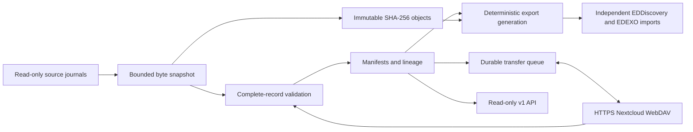

# Architecture

Journal Cloud captures, validates, archives, synchronizes, and exports Elite Dangerous
journal history. It runs independently of the game and of EDDiscovery/EDEXO. Decky and VR
will consume the versioned read-only API; their UI code does not belong here.

## Package boundaries

| Area | Responsibility |
| --- | --- |
| `journal/` | Windows/Proton discovery, complete-record parsing, Fileheader identity |
| `storage/` | SHA-256 objects, manifests, derived lineage, SQLite transfer state |
| `sync/` | Nextcloud WebDAV adapter, publication order, downloads, retry/recovery |
| `feed/` | Prefix consolidation, divergent-history detection, consumer directory adapters |
| `api/` | Opt-in GET-only loopback HTTP service with `/v1` contracts |
| `cli/` | Idempotent config, local credentials, scan/sync/status/verify/export/serve |



## Snapshot and storage contracts

A capture reads the size observed at open and records the source basename, mtime in nanoseconds,
observed byte length, generated device ID, derived commander identifiers, header timestamp,
session ID, raw hash, complete-prefix hash, and complete byte count. It never writes the source.
Append growth is picked up next scan; detected shrink causes rejection and a rescan. Concurrent
in-place rewrites are outside the normal append-only game behavior and cannot be made atomic
without source-side cooperation. Run a final scan after game shutdown for migration validation.

The entire captured byte string, including a partial tail, is stored at
`objects/<first-two-hash-characters>/<sha256>`. Only bytes through the final LF are parsed.
UTF-8, optional initial BOM, and CRLF are supported without rewriting bytes. A valid snapshot
starts with Fileheader and has timestamped JSON event objects on every complete line. Unknown
event names/fields are retained. A malformed complete line rejects ingestion; its raw object
is retained locally without a published manifest. A partial first Fileheader also stays unindexed
until complete. Snapshot limit: 128 MiB. Manifest limit: 64 KiB. No event-count or credit totals
from historical incidents are embedded in parser or fixture logic.

Session identity is SHA-256 of canonical JSON of the complete first Fileheader, including its
part and timestamp. It is a grouping identity, not proof that devices share a session. Exact
complete-byte equality or prefix inclusion establishes compatible history. Full raw hashes
identify capture objects. Manifest IDs hash sorted, compact, ASCII-escaped JSON of all metadata.
SQLite schema version 1 stores these canonical manifests, all strict-prefix lineage edges, and
transfer jobs. Source absolute paths are excluded from manifests; configured roots remain local.
The originating basename and mtime are retained as metadata; source filesystem ACLs, creation
time, and extended attributes are not cloned. Export mtimes are not source provenance.

## Synchronization contract

The configured Nextcloud collection must exist. All paths below it are:

```text
v1/devices/<device-id>/objects/<raw-sha256>
v1/devices/<device-id>/manifests/<manifest-sha256>.json
```

Device IDs accept ASCII letters, numbers, underscore, and hyphen (1–64 characters). New IDs are
random UUID hex strings, not hostnames. Every installation has its own state directory/ID.
Objects are globally deduplicated locally and device-separated remotely. Shared content across
devices can exist more than once remotely to preserve independent device archives. Clients may
replicate imported immutable manifests under their original device ID; they never relabel origin.
No deletes, mutable head pointers, remote SQLite, or timestamp-based last-writer-wins operations
are used. Use a dedicated collection; all clients with write access are trusted.

Before network discovery, local manifests become persistent upload jobs scoped to a hash of
the collection URL and username. Changing endpoint/user creates separate jobs, retaining the
old endpoint's history. Uploads create collections, conditionally PUT the object (`If-None-Match:
*`), GET/hash-check it, then conditionally PUT and GET/hash-check the manifest. Existing remote
bytes must match; no overwrite is attempted. Manifests are the publication marker.

Depth-1 PROPFIND enumerates devices and their manifests. An interrupted device with no manifest
collection is skipped. Every remote manifest has a hash-checked filename and validated schema,
device binding, safe basename, and derived fields. Downloads fetch the referenced object, verify
its raw hash and every derived field, then commit local ingestion. A manifest download and its
object fetch are one restartable queue job; an interruption reruns the job rather than resuming
an unverified byte range. Remote objects with no published manifest are ignored.

Jobs transition `pending → in_progress → transport_verified` for uploads or `ingested` for
downloads. Retryable failures transition to `retry` with `min(3600, 2**attempts)` seconds of
backoff; eight failed attempts or a permanent error transition to `failed`. `sync --retry-failed`
explicitly resets failed jobs for the current endpoint. Discovery errors appear separately and
are retried on the next command. Discovery itself is not a queue job. A process-wide filesystem
lock allows one archive writer/worker at a time. On reopening after a crash, `in_progress` jobs
become immediately eligible `retry` jobs. A running worker cannot be mistaken for a crashed one.

`transport_verified` is neither a server-side archive ingestion acknowledgement nor a consumer
import acknowledgement. `ingested` means this client's validated local transaction completed.
Remote ingestion and consumer import remain `unknown`. No server-side archive receiver is
required by this transport.

## Feed and integration contracts

For each header group, equal complete prefixes collapse and strict prefixes yield to maximal
snapshots. No individual event deduplication, timestamp sorting within files, biological-credit
recalculation, or JSON reserialization occurs. Divergent maximal snapshots are retained in the
archive. Normal export refuses them; `--allow-conflicts` permits separate branches for review,
which can repeat shared-prefix events and must not be blindly imported together.

`export` requires a new/empty destination and writes `feed.json` last. Its presence is the
completion marker. Generic exports use opaque commander/session/content subdirectories and
original journal basenames. The `eddiscovery` and `edexo` adapters provide flat per-commander
folders with original basenames; they refuse collisions. Configure each consumer independently
for a chosen commander folder. Multi-commander source files remain intact and must be reviewed;
unknown commander files have their own opaque grouping. No adapter drives a consumer UI or
asserts that an import happened. Real consumer validation is documented in `migration.md`.

The HTTP API reads committed SQLite state using `mode=ro` without acquiring a worker lock.
See [API contract](api.md), [security boundaries](../SECURITY.md), and the
[ADRs](adr/README.md). Python imports are implementation details; CLI JSON, API v1, manifest
schema 1, WebDAV v1, and feed schema 1 are the integration surfaces. Additive fields may appear.

## Deliberate limits

Full snapshots and pairwise prefix comparisons favor correctness over archive-scale performance.
There is no watcher, scheduler, retention/garbage collection, server acknowledgement protocol,
range resumption, encrypted content envelope, cryptographic device identity, pagination, or
legacy receiver import adapter yet. Optional private HTTP/Tailscale transport can later implement
the same publication and integrity contract; it is not required or implemented in this slice.
